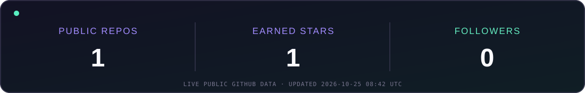

<!-- REAPBONE // PERSONAL GITHUB PROFILE -->
<div align="center">

<a href="https://github.com/Reapbone"></a>

<br />

<a href="https://reapbone.github.io/reapbone/"></a>
<a href="https://github.com/Reapbone?tab=repositories"></a>
<a href="https://github.com/Reapbone?tab=followers"></a>

<br /><br />


</div>

### `> hello_world 👋`

I'm **Reapbone**, a curious developer who genuinely loves **building things with AI**. For me, the fun is turning a wild idea into something that *actually works* — experimenting, breaking things, learning, and building again.

> **My favorite workflow:** `imagine → prototype → test → improve → ship`.

```typescript
const reapbone = {
  mindset: "learn by building",
  passion: ["AI", "creative coding", "automation", "experimentation"],
  currentMode: "creating something new",
  nextStep: "keep building",
};
```

### `> inside_the_lab` 



<table>
<tr>
<td width="50%" valign="top">

<strong>🧠 WHAT DRIVES ME</strong>
<ul>
<li>Turning AI-assisted ideas into useful creations.</li>
<li>Exploring new tools and techniques.</li>
<li>Building, debugging, and continuously improving.</li>
<li>Learning by experimenting, not just watching.</li>
</ul>

</td>
<td width="50%" valign="top">

<strong>⚡ CURRENT SIGNAL</strong>
<ul>
<li><strong>Passion:</strong> AI-powered development</li>
<li><strong>Approach:</strong> Curiosity + practical coding</li>
<li><strong>Mindset:</strong> Always learning</li>
<li><strong>Mode:</strong> Build → Test → Repeat</li>
</ul>

</td>
</tr>
</table>

### `> worlds_i_like_to_build`

Alongside AI, I'm interested in **game servers, developer tools, automation, and backend systems** — practical spaces where an experiment can become something useful.

### `> live_signals`

<div align="center">

</div>

<details>
<summary><b>🧪 OPEN LAB NOTES — click to expand</b></summary>
<br />

**How I like to create**

1. Start with an idea worth exploring.
2. Break it into small, testable pieces.
3. Use AI as a creative development partner.
4. Build, verify, refactor, and repeat.
5. Share what I discover.

**What you'll find here:** experiments, prototypes, evolving projects, and ideas in motion. I prefer shipping something real to waiting for something perfect.

</details>

<details>
<summary><b>🌐 TÜRKÇE — hakkımda</b></summary>
<br />

Selam! Ben **Reapbone**. Yapay zekâ kullanarak yeni şeyler geliştirmeyi, fikirleri çalışan projelere dönüştürmeyi ve sürekli yeni teknolojiler denemeyi seviyorum. Bu profilde deneylerimi, geliştirdiğim araçları ve öğrenme sürecimi paylaşıyorum.

**Fikir üret → Kodla → Test et → Geliştir → Paylaş.**

</details>

### `> contribution_matrix`

<div align="center">

<!-- First snake workflow run creates the output branch image. -->
<picture>
  <source media="(prefers-color-scheme: dark)" srcset="https://raw.githubusercontent.com/Reapbone/reapbone/output/github-snake-dark.svg" />
  <source media="(prefers-color-scheme: light)" srcset="https://raw.githubusercontent.com/Reapbone/reapbone/output/github-snake-light.svg" />
  
</picture>

</div>

---

<div align="center">

**Have an interesting idea? Let's build something cool.**

<a href="https://reapbone.github.io/reapbone/">🚀 Interactive world</a> &nbsp;·&nbsp; <a href="https://github.com/Reapbone?tab=repositories">🧩 My repositories</a> &nbsp;·&nbsp; <a href="https://github.com/Reapbone">💜 GitHub</a>

<sub>Crafted with curiosity · Built to evolve · REAPBONE / 2026</sub>

</div>
