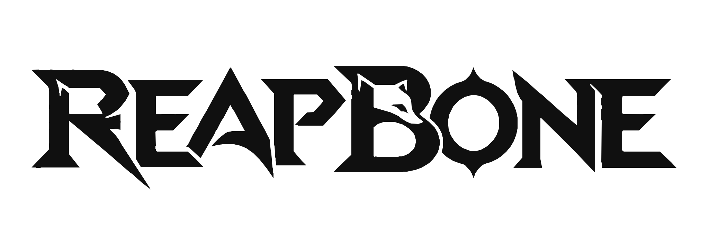
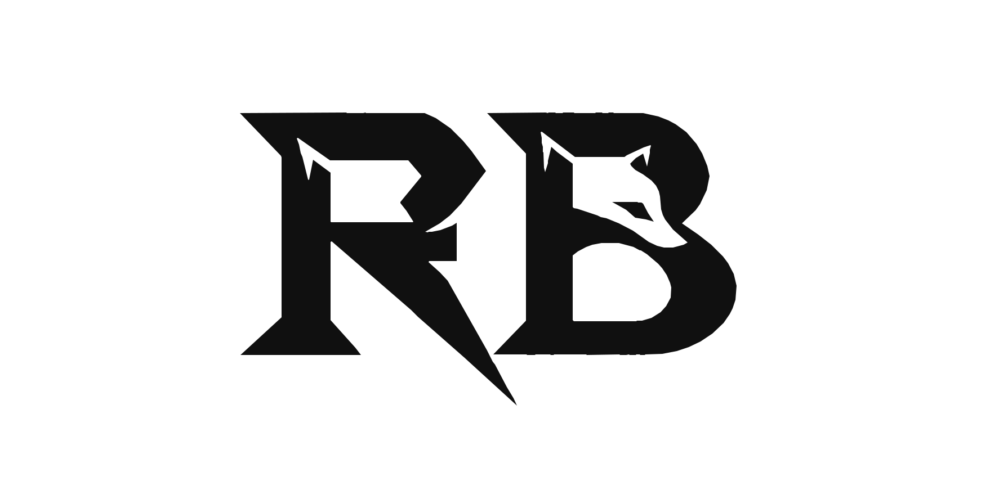

<!-- REAPBONE / BLACK & WHITE EDITION -->
<div align="center">
  <picture>
    <source media="(prefers-color-scheme: dark)" srcset="./assets/wordmark-light.svg">
    
  </picture>

  <br>
  <strong>AI-ASSISTED DEVELOPMENT · AUTOMATION · CREATIVE TOOLS</strong>
  <br><br>

  <a href="https://reapbone.github.io/reapbone/"></a>
  <a href="https://github.com/Reapbone?tab=repositories"></a>
  <a href="https://github.com/Reapbone?tab=followers"></a>
</div>

---

<table>
<tr>
<td width="74%" valign="top">

### `> whoami`

Hey! I'm **Reapbone**, a developer who loves building things with **AI as a creative development partner**. I enjoy turning ideas into practical tools, testing possibilities, improving systems and learning through real projects.

My interests include **Discord bots, game-server tooling, automation, backend systems and AI-assisted development**.

```text
idea → prototype → test → refine → ship
```

</td>
<td width="26%" align="center" valign="middle">
  <picture>
    <source media="(prefers-color-scheme: dark)" srcset="./assets/monogram-light.svg">
    
  </picture>
</td>
</tr>
</table>

### `> system_status`

<div align="center">
  
</div>

### `> what_i_do`

- **AI-assisted applications** — turning concepts into useful tools with careful review and testing.
- **Discord & community systems** — bots, slash commands, embeds and practical integrations.
- **Automation & tooling** — utilities that remove repetitive work.
- **Experimentation** — learning new technologies through building and iteration.

### `> commissions_open`

**Open to paid freelance / commissioned projects.** I can work on custom bots, automations and AI-assisted software solutions. Using AI as part of my workflow doesn't replace testing, quality checks or responsibility for the final result.

Interested in working together? Reach out through my **[GitHub profile](https://github.com/Reapbone)**.

<details>
<summary><b>🇹🇷 Türkçe — Hakkımda ve hizmetler</b></summary>

Merhaba! Ben **Reapbone**. Yapay zekâ destekli yazılım geliştirmeyi ve fikirleri çalışan projelere dönüştürmeyi seviyorum. Discord botları, otomasyon, oyun sunucusu araçları ve yeni yazılım teknolojileriyle ilgileniyorum.

**Ücretli özel projelere açığım.** Yapay zekâdan geliştirme sürecinde yararlanıyorum; ortaya çıkan işleri test etmeyi, geliştirmeyi ve ihtiyaca uygun şekilde teslim etmeyi önemsiyorum.

İletişim: [GitHub profilim](https://github.com/Reapbone)
</details>

### `> activity_signal`

<div align="center">
  
</div>

---

<div align="center">
  <strong>BUILD WITH CURIOSITY. SHIP WITH CARE.</strong>
  <br><br>
  <sub>REAPBONE · BLACK / WHITE · 2026</sub>
</div>
